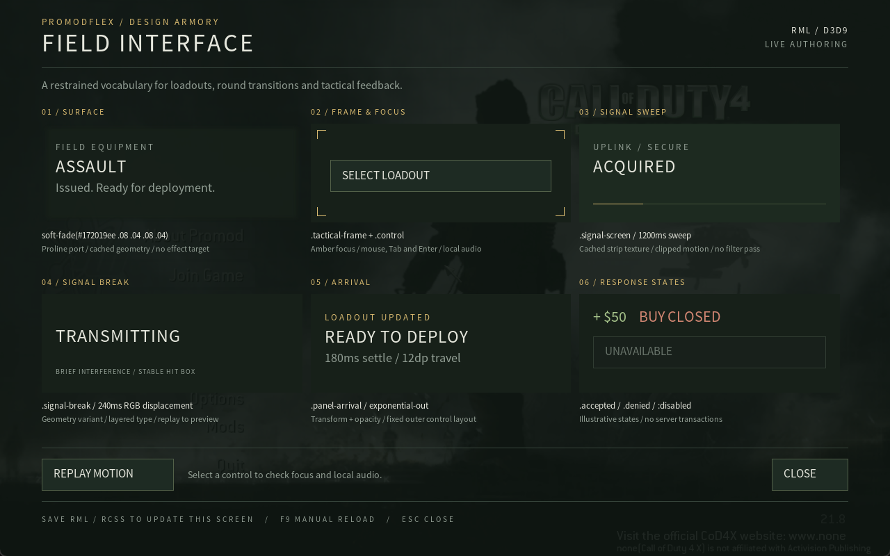
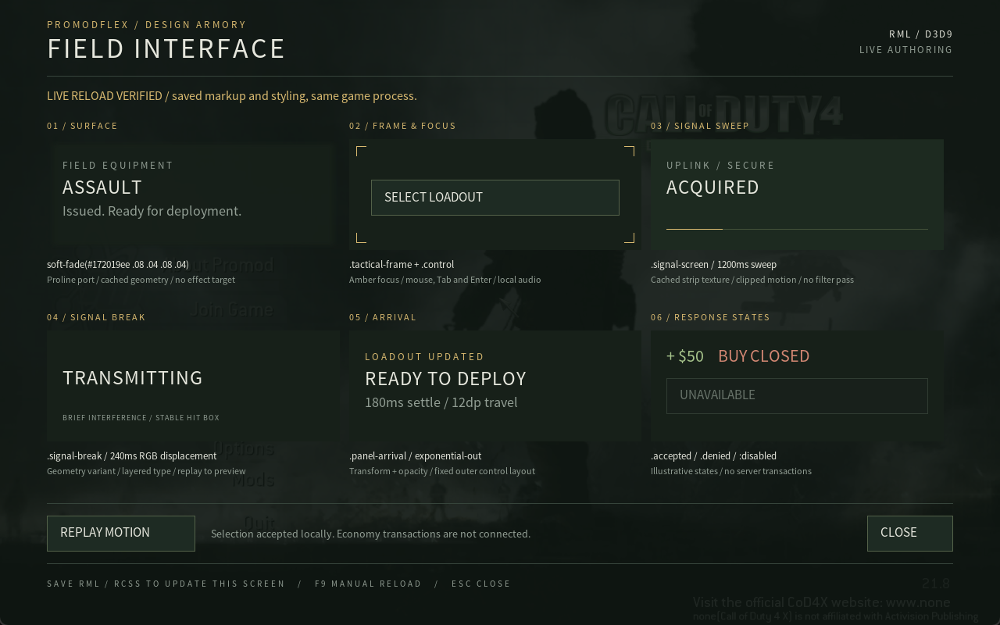

# CoD4 palette and live source acceptance

Verified locally on 2026-11-06, Windows, NVIDIA GeForce RTX 3050. Client branch base: `1c0c6a61bdbea0e43fd4578033462b287ea0f6e6`, with the accompanying working-tree changes. Mod source branch: `feat/rml-ui-foundation` at `f5e610fe5bb9860e16399935bf1cfffa97532eec`. Native game acceptance used the existing released **PromodFlex 0.1.16** mod, not a newly linked gameplay mod.

## Inputs and isolation

- The [C4S downloads page](https://www.cod4-server.com/?page=downloads) links `https://fastdl.cod4-server.com/mods/Cod/Cod4xGameFull.zip`, downloaded to `C:\development\downloads\Cod4xGameFull.zip`. Length: 5,937,188,752 bytes. Locally calculated SHA-256: `6d5c4830d90e22b99a3de6bac6104838b63a9b45f8004cc49944c917d71f283f`. This records downloaded bytes, not publisher authentication.
- Only the multiplayer executable, runtime libraries, localization and `main`, `zone`, `miles` assets were extracted under `C:\development\games\cod4`. Bundled installers, registry files and key lists were not extracted or executed. The 32-bit `d3dx9_34.dll` was copied from this machine's `Windows\SysWOW64` into that workspace game folder.
- `PromodFlex-Client.zip` was downloaded with `gh release download promodflex-v0.1.16 --repo laspencer91/cod4-promod-releases`. Its SHA-256 `c4b1e137768096855c2402c7ad2c5263b094572f4fbffd84670ded8276b3fe66` matched the release's `SHA256SUMS.txt`. Its `Call of Duty 4/mods/pmflex` files were staged into the private runtime by `Stage-Game.ps1`.
- The workspace also has `promod/CoD4-Mod-Tools` and the six canonical `prosmoke/grids/cod4` files for subsequent gameplay builds. The released mod was sufficient for this host/palette acceptance; no gameplay relink is claimed.
- Tools used: MinGW GCC 8.1.0 i686/posix/dwarf, NASM 2.16.03, CMake 3.31.11 and portable Python 3.13.9 under `C:\development\Tools`. The vendor verification script verified 486 RmlUi and 672 FreeType pinned files.

All game launches used `build-rml/lab`, a private app-data/profile directory, disabled UDP/IPX, `TEST_ISOLATION=ON`, and the explicitly built client DLL. No installer ran against an existing Steam game or existing user profile. The source game folders are linked into this runtime; do not recursively delete those junctions with a tool that follows them.

## Automated checks

`tools/rml/Build.ps1` builds the full 32-bit client with `RMLUI=ON`, `RMLUI_TESTS=ON`, `VOLUMETRIC_SMOKE=ON`, and `TEST_ISOLATION=ON`. CTest cases:

| Case | Observed checks |
| --- | --- |
| `rml_native` | Real D3D9 pixels, premultiplied alpha, glyphs, TGA orientation, scissor, transforms, state restoration, upload reuse, native device reset, model/input lifecycle, and retained document on load failure. |
| `rml_cpu` | Actual diagnostic/palette documents, click and Enter, disabled controls, hover deduplication, focus loss with a held button, Escape, bounded tickets, model retention and typed screen selection. |
| `rml_source` | Real source files, save coalescing, a same-size RCSS rewrite that changes layout, RML component changes, missing-document retention/recovery, reload status and namespace traversal rejection. Its timed loop allows asynchronous Windows file notifications to arrive. |
| `rml_palette` | First-open button-text pixels, identical button text after reload, screen switching and native captures at 1280x800, 1024x768 and 3440x1440. |

The [retained test log](2026-11-06-rml-palette-tests.log) records all four passes. Captures include `build-rml/rml-palette-first.png`, `rml-palette-4x3.png` and `rml-palette-ultrawide.png`. GCC 8.1 emits existing upstream enum-bitfield warnings; no vendor changes were made to suppress them. [Source and binary hashes](2026-11-06-rml-source-hashes.json) identify the final local implementation.

## Native game observations

The initial fullscreen launch recorded CPU frames without replaying them while its D3D9 device was lost. A private relaunch with windowed `1280x800` set before renderer initialization replayed the UI. First-open text and animation timing were then corrected by resolving initial layout before recording and giving the host the client's elapsed time before opening a screen.

For the recorded live-edit run, **the same native game process, PID 32116**, remained open:

1. Opened the palette via `rml_palette`. An engine screenshot showed the six samples over the native Promod main menu, including full control/arrival text. Status: `recorded=478 rendered=478 pending=0 result=0x00000000 activations=0`.
2. Activated the game window and sent native Tab/Enter. The local action count became `activations=1`; this makes no purchase and does not claim a human auditory check.
3. Saved a changed lead sentence in `palette.rml` and changed its RCSS color from muted to amber. Without `rml_reload`, the console logged `source reloaded`; the next engine screenshot showed the new sentence and color. Status: `recorded=2503 rendered=2503 pending=0 result=0x00000000 reloads=1 failed=0 activations=1`.
4. Restored both source files while the same process stayed open. Another automatic reload returned the original text/color. Status: `recorded=4795 rendered=4795 pending=0 result=0x00000000 reloads=2 failed=0 activations=1`. The bound local action state survived both saves.

The compact [native console record](2026-11-06-rml-live.log) and the paired engine captures are retained here:

Subsequent acceptance resolved a native input mapping error: CoD4 emits `174/175` for F8/F9 and `158/159/160` for Alt/Ctrl/Shift; the generic Quake header used different numbers. The adapter and host now share `src/rml/native_keys.h`, and the CPU test sends literal native navigation/modifier/keypad values through actual RmlUi events. The private test build handles F8 before native menu capture, and modal F9 before the host consumes ordinary keys. Native F9 logged `screen reloaded` in process 20724; native Escape then logged `visible=0`. After the private F8 routing fix, native F8 opened the palette and F9 logged `screen reloaded` in process 10740; see the [native shortcut log](2026-11-06-rml-hotkeys.log). No console command was used to open that latter palette.

The staged-asset path was also run with `Run-Game.ps1 -Packaged`, without the source override. In process 29276 the native palette rendered, `vid_restart` reinitialized the renderer, and reopening the palette resumed equal recorded/rendered counts with no pending frames or HRESULT failure. The capture is `build-rml/lab/game/mods/rmllab/screenshots/shot0010.tga`; its console record is retained locally at `build-rml/rml-packaged-reset.log`. This reset check did not include active world smoke.

## Scope limits

This verifies the host/palette and live source workflow. It does not replace the economy screen or connect its GSC transactions. The signal-break cell uses displaced text geometry; Proline's full row-band glitch, dissolve, grime, masks, layer compositing, particles and scene blur remain separate backend work. Source reload may reset DOM focus/scroll and local animation phase. Fonts require restarting the host. A human audio check, camera/fire suppression during actual play, and active smoke rendering through an in-game device reset are still pending.
